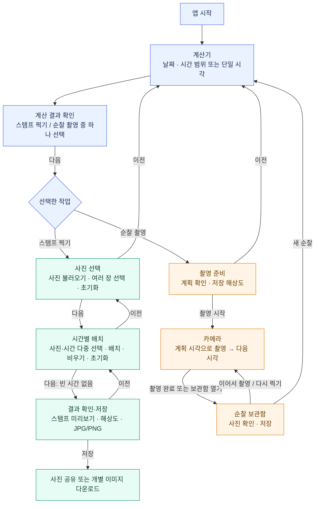
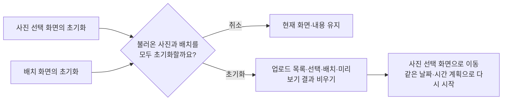

# 타임스탬프 화면 전환 및 변경 요구사항 초안

작성일: 2026-11-11 (한국 시간)  
상태: 사용자 검토 대기 · 구현 전  
대상: 현재 모바일 웹 앱 `web/` 기준

이 문서는 요청한 여섯 가지 변경과 제안 화면 흐름을 정리한 초안이다. 앱 코드 수정·빌드·배포는 진행하지 않는다. 플로우차트 확인 후 세부 정책을 확정하고, 구현은 별도 요청을 받은 뒤 진행한다. Windows 앱에도 같은 변경을 적용할지는 별도 확인 대상으로 둔다.

요청한 `archify` 스킬은 현재 제공된 스킬 목록 및 확인한 로컬 설치 경로에서 찾지 못했다. 아래 차트는 Mermaid로 작성한 대체 초안이며, archify를 실행한 결과가 아니다.

## 1. 요청사항

| 번호 | 요청 | 제안 화면에서의 반영 위치 |
| --- | --- | --- |
| 1 | 사진 여러 장을 선택하고, 선택한 사진을 다시 누르면 해당 사진만 선택 해제 | 사진 선택 화면과 배치 화면의 사진 목록 |
| 2 | 배치할 시간과 비울 시간을 여러 개 선택하고, 다시 누르면 선택 해제 | 시간별 배치 화면 |
| 3 | ZIP 다운로드 기능 제거 | 스탬프 결과 저장 및 순찰 보관함 |
| 4 | 시간 범위 외에 단일 시각도 지정 | 공통 계산기 화면의 시간 지정 방식 |
| 5 | 사진 선택과 배치 단계 모두에서 업로드 내용을 초기화하고 다시 시작 | 두 화면에 초기화 버튼 제공 |
| 6 | 스크롤로 단계를 찾아가는 구조를 화면 전환 방식으로 변경. 계산기에서 스탬프/순찰을 선택하고 다음 단계로 이동 | 공통 진입 및 두 작업 흐름 전체 |

## 2. 현재 구조에서 확인한 점

- `web/src/main.ts`: 계산기·스탬프 찍기·순찰 촬영을 하단 탭으로 직접 이동한다. 첫 진입 기본값은 순찰 촬영이며, 이후에는 마지막 탭을 기억한다.
- `web/src/pages/calculator.ts`: 계산 결과를 스탬프 또는 순찰로 전달하며, 자동 입력 체크박스가 있다.
- `web/src/pages/batch.ts`: 시간 입력·사진·배치·내보내기가 한 화면에 나열되어 있다. 파일 불러오기는 이미 여러 장을 지원하지만, 불러온 사진 목록에서 작업 대상으로 선택하는 사진은 한 장뿐이다. 시간도 하나만 선택한다.
- `web/src/pages/patrol.ts`: 설정 → 카메라 → 보관함으로 화면이 바뀐다. 촬영 성공 후 다음 계획 시각으로 넘어가고, 실패하면 같은 시각을 유지한다.
- `web/src/pages/planform.ts`, `web/src/core/patrol.ts`: 시간 입력은 시작·종료 범위만 지원한다. 같은 시작·종료 시각은 오류이고, 시작 5분 후부터 종료까지 시간을 만든다.
- `web/src/stamp/export.ts`: 공유 미지원 안내가 ZIP 다운로드를 권한다. ZIP 버튼 제거 시 이 안내와 저장 경로도 함께 정리해야 한다.

## 3. 전체 플로우차트 — 우선 확인할 안

계산기를 공통 시작 화면으로 사용한다. 계산기 안에서 시간을 설정하고 작업 종류 하나를 선택한 뒤 **다음**을 누른다. 스탬프 작업은 사진 선택·배치·결과 확인을 각각 별도 화면으로 전환한다.

차트의 화살표는 페이지 안의 해당 위치로 스크롤하는 동작이 아니라, 현재 화면을 다음 단계 화면으로 바꾸는 동작이다. 사진이 많을 때 목록 내부를 스크롤하는 것은 허용한다.

## 4. 화면별 동작 제안

### 공통: 계산기와 작업 선택

1. 날짜와 시간 지정 방식 **시간 범위 / 단일 시각**을 선택한다.
2. 시간 범위는 시작·종료를 입력한다. 기존처럼 출발 5분 뒤부터 종료까지 5분 간격으로 계산한다. 자정을 넘으면 다음 날짜를 적용한다.
3. 단일 시각은 날짜와 시각 하나만 입력한다. 예: `2026-11-11 23:17`을 입력하면 그 시각 자체를 사용한다. 시작 시각에 5분을 더하지 않으며 종료 입력은 표시하지 않는다.
4. 결과를 확인하고 **스탬프 찍기 / 순찰 촬영** 중 하나를 선택한 뒤 **다음**을 누른다. 입력 오류나 작업 미선택 상태에서는 다음으로 진행하지 않는다.
5. 초안에서는 단일 시각을 사진 한 장이 들어가는 시간 칸 하나로 제안한다. 스탬프는 한 장을 배치하고, 순찰은 한 번 촬영 후 보관함으로 이동한다. 같은 시각을 여러 사진에 반복 적용하는 기능은 아직 확정하지 않는다.

**제안:** 계산한 계획을 다음 화면에 항상 전달한다. 현재의 ‘자동 입력’ 체크박스 대신 하나의 계획을 단계 전체가 공유한다. 새 작업의 진입은 계산기로 통일하고, 진행 중인 순찰은 계산기의 **이어서 촬영 / 보관함**에서 바로 접근할 수 있게 한다. 기존 저장 사진은 새 진입 화면 때문에 지워지지 않도록 한다.

### 스탬프 1단계: 사진 선택

- 여러 파일을 한 번에 불러올 수 있다.
- 사진 타일을 한 번 누르면 선택, 다시 누르면 해당 사진만 선택 해제한다. 다른 사진의 선택 상태는 유지한다.
- 선택 표시와 **선택 N장**을 보여준다. 단순 선택 해제는 업로드 목록에서 사진을 삭제하는 동작과 구분한다.
- **선택 사진 제외**는 현재 선택한 사진들을 작업 목록에서 제외한다. 원본 파일은 삭제하지 않는다.
- **이전 / 다음 / 초기화**를 제공한다. 다음을 누를 때 선택한 사진이 없으면 안내한다.
- 선택한 사진만 배치 단계의 작업 대상으로 전달하는 방식을 제안한다. 이전을 눌러 돌아오면 불러온 목록과 선택 상태를 유지한다.

### 스탬프 2단계: 시간별 배치

- 사진 목록과 시간 목록에서 각각 여러 항목을 토글 방식으로 선택한다. 목록은 같은 배치 화면 안에서 함께 접근할 수 있게 한다.
- **선택 사진 N장 / 선택 시간 M개**를 표시한다. 시간의 ‘선택됨’과 ‘사진이 배치됨’은 서로 다른 표시를 쓴다.
- 버튼 이름은 **선택 시간에 배치**, **선택 시간 비우기**로 바꾼다. 비우기는 사진 선택 없이도 실행할 수 있다.
- **순서대로 / 랜덤 배치**는 유지한다. 초안에서는 1단계에서 작업 대상으로 고른 사진 전체를 계획 시간 전체에 배치하는 기능으로 둔다. 수동 다중 선택과의 적용 범위를 안내한다.
- 사진을 확인하려는 동작과 선택 토글이 충돌하지 않도록 별도의 미리보기 버튼을 제공하는 방식을 제안한다. 미리보기를 열고 닫아도 선택 상태는 바뀌지 않는다.
- **다음**은 모든 시간에 사진이 배치되어야 가능하다. 사진이 남는 것은 허용하고, 빈 시간은 개수와 위치를 알려준다.
- **이전 / 다음 / 초기화**를 제공한다.

수동 다중 배치의 세부 규칙은 다음과 같이 제안한다. 사용자 확정 사항은 아니다.

| 상황 | 제안 동작 |
| --- | --- |
| 사진 N장, 시간 N개 선택 | 사진 목록에 보이는 순서와 시간의 날짜·시각 순서로 일대일 배치 |
| 사진 수와 시간 수가 다름 | 배치 전에 수를 맞추도록 안내하고 기존 배치를 유지 |
| 사진 1장, 시간 1개 선택 | 기존의 단일 배치·사진 교환 규칙 유지 |
| 여러 장 중 이미 다른 시간에 배치된 사진이 있음 | 한 번의 작업으로 기존 위치에서 이동. 선택 시간에 있던 밀려난 사진은 대기 목록으로 복귀하며, 사진 중복 배치 방지 |
| 선택한 여러 시간이 이미 채워져 있음 | 해당 시간들만 교체. 위의 이동으로 비게 되는 기존 시간도 함께 갱신 |
| 선택 시간 비우기 | 선택한 시간들의 배치만 해제. 사진은 목록에 남고 재배치 가능 |
| 배치·비우기 완료 | 오작동 방지를 위해 해당 작업의 선택 표시를 해제하고 결과 개수를 안내 |

### 사진 선택·배치 화면의 초기화

요청한 ‘업로드 내용을 초기화하고 처음부터 다시 시작’에 맞춰 **두 화면의 초기화 버튼은 같은 전체 초기화 동작**으로 제안한다.

- 날짜·시간 계획과 선택한 작업 종류는 유지한다. 시간을 바꾸려면 계산기로 돌아간다.
- 배치 화면에서 전체 초기화를 하면 사진 선택 화면으로 돌아온다.
- 단순히 일부 배치를 지우려면 **선택 시간 비우기**를 사용한다.
- 원본 기기 사진과 순찰 보관함은 스탬프 초기화 대상에 포함하지 않는다.
- 사진 불러오기·합성 처리 중에는 초기화와 중복 실행을 막고 처리 상태를 표시한다.

### 스탬프 3단계: 결과 확인·저장

- 시간순 결과 목록, 스탬프 미리보기, 출력 해상도와 JPG/PNG 형식을 표시한다.
- **이전**으로 돌아가 사진 배치를 수정할 수 있다. 이전 이동만으로 업로드·배치가 초기화되지 않는다.
- ZIP 버튼과 ZIP 생성 경로를 제거한다. ZIP 이용을 권하는 오류 안내도 함께 제거한다.
- **사진 준비 → 저장 버튼 → 공유 시트** 흐름은 유지한다. 공유 시트 취소는 저장 완료로 표시하지 않는다.
- **제안:** 파일 공유가 지원되지 않으면 결과별 **이미지 다운로드**를 제공한다. ZIP 없이도 브라우저에서 결과를 받을 수 있게 하려는 방안이며 실제 기기 검증이 필요하다.

### 순찰 촬영 흐름

- 계산기에서 선택한 계획을 촬영 준비 화면에 표시한다. 시간 재입력 없이 해상도 등을 확인한 뒤 시작한다.
- 시간 범위는 기존처럼 촬영 성공 시 다음 계획 시각으로 넘어간다. 단일 시각은 한 번 촬영하면 완료한다.
- 저장 실패 시 같은 시각을 유지하고 다시 시도할 수 있다.
- 보관함에서 이어서 촬영·다시 찍기·개별 저장·모두 저장을 제공한다. ZIP 다운로드는 제거한다.
- 카메라를 벗어나면 카메라를 해제한다. 진행 중인 순찰과 새로고침 복원은 유지한다.
- **새 순찰**은 계산기로 돌아가 새 계획을 정하는 흐름이다. 돌아가는 동작만으로 기존 사진을 삭제하지 않는다. 새 촬영 시작 시 기존 사진 교체가 필요하면 현재처럼 안내하고 확인한다.

## 5. 단계 이동과 상태 유지

| 동작 | 제안 규칙 |
| --- | --- |
| 이전·다음 | 현재 작업의 사진·선택·배치를 유지 |
| 시간 계획을 바꾸지 않고 계산기에서 복귀 | 기존 작업 상태 유지 |
| 시간 계획 변경 | 사진 목록 유지. 날짜·시각이 정확히 일치하는 배치만 유지하고, 빠진 시간의 사진은 대기로 이동. 이전 결과물은 다시 생성 |
| 스탬프 전체 초기화 | 스탬프 사진·선택·배치·준비한 출력 비우기. 시간 계획 유지 |
| 순찰 도중 계산기 이동 | 진행 중인 순찰을 보존. 이어서 촬영 시 저장된 순찰 계획 사용 |
| 앱 새로고침 | 기존 순찰 복원 기능 유지. 스탬프 작업의 새로고침 복원은 이번 요청에서 추가 확정하지 않음 |

**제안:** 새 작업의 화면에는 현재 단계 표시와 하단 이전·다음 버튼을 둔다. 기존의 자유 이동 하단 탭을 단계 진행 버튼으로 대체해 계산기에서 정한 흐름을 따른다. 화면 전환 시 새 화면 제목부터 보여주고 키보드 포커스도 이동한다.

## 6. 검토할 핵심 결정

요청으로 확정된 것은 여섯 가지 변경 방향이다. 다음 네 가지는 초안을 구체화하기 위한 제안이므로 함께 확인한다.

1. **진입과 단계:** 계산기에서 시간·작업을 선택한 후 다음으로 진행. 스탬프는 사진 선택 → 시간별 배치 → 결과 확인·저장으로 구성한다.
2. **단일 시각의 의미:** 시간 칸 하나와 사진 한 장으로 처리하고, 순찰 촬영에도 같은 방식을 적용한다.
3. **다중 배치:** 사진과 시간 수를 맞춰 목록 순서대로 일대일 배치한다. 한 사진을 여러 시간에 복제하지 않는다.
4. **초기화 범위:** 사진 선택·배치 양쪽에서 스탬프 업로드와 배치를 모두 비우고, 시간 계획은 유지한 채 사진 선택부터 다시 시작한다.

## 7. 추후 구현 시 확인할 항목

현재 실행한 테스트가 아니라, 승인 후 구현 결과를 확인할 기준이다.

- 사진 A·B·C 선택 후 B를 다시 누르면 A·C만 선택 상태로 남는다. 시간도 같은 방식으로 동작한다.
- 사진 3장과 시간 3개를 선택하면 순서대로 배치되고, 시간 2개를 비우면 해당 두 칸만 비며 사진은 다시 사용할 수 있다.
- 사진·시간 개수가 다르면 기존 배치가 부분적으로 바뀌지 않는다. 이미 배치된 사진을 이동해도 같은 사진이 두 시간에 중복되지 않는다.
- 단일 `2026-11-11 23:17`은 그 날짜·시각 한 칸만 만든다. 기존 범위 `23:00~23:30`은 여전히 23:05부터 23:30까지 6칸을 만든다.
- 두 초기화 버튼은 모두 사진·선택·배치를 비우고 사진 선택 화면으로 돌아가며, 취소 시 아무것도 바꾸지 않는다.
- 스탬프 각 단계가 별도 화면으로 전환되고, 이전·다음만으로 사진이 사라지지 않는다.
- ZIP 버튼·생성 기능·ZIP 권유 안내를 제거한다. 공유 성공·취소·미지원 및 개별 이미지 다운로드를 확인한다.
- 기존 ZIP 기반 자동 검증은 사진 Blob·공유·개별 다운로드 검증으로 바꾼다. 스탬프 디자인·출력 품질과 순찰 저장·복원 검증은 유지한다.
- 모바일 실제 기기에서 공유 시트, 이미지 저장, 카메라 권한, 뒤로 이동을 확인한다.

이 초안의 검토 결과를 반영한 뒤 구현 범위를 확정한다. 이 문서 자체는 구현 착수 승인을 뜻하지 않는다.
